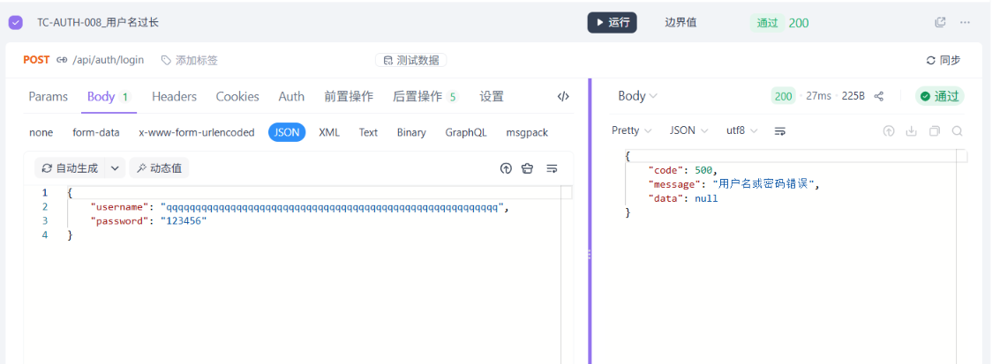
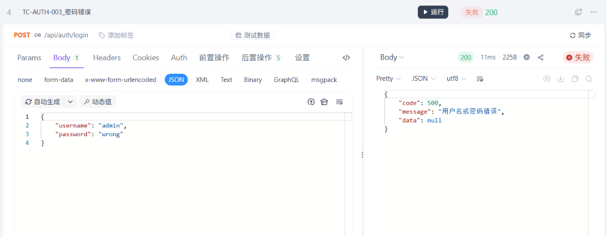
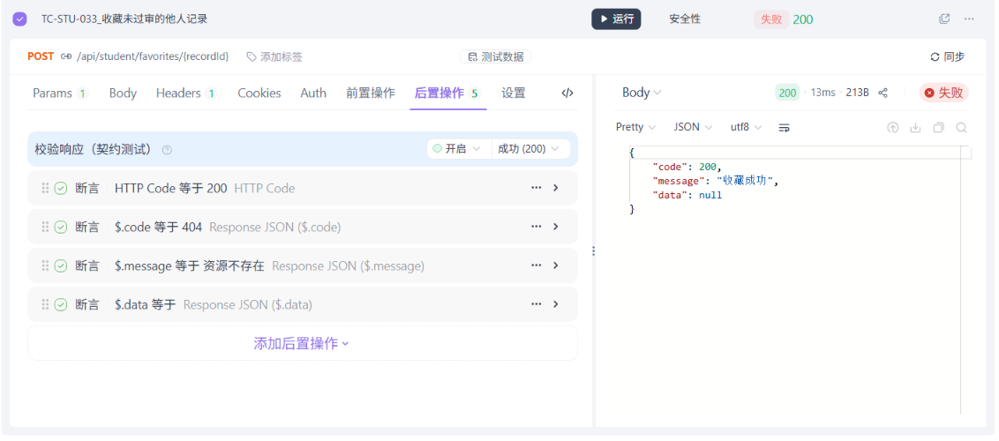
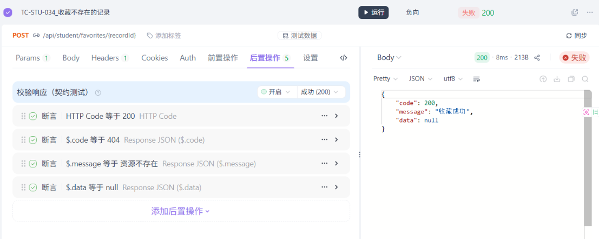
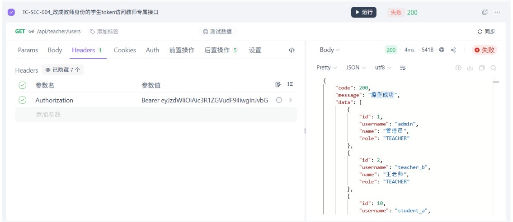
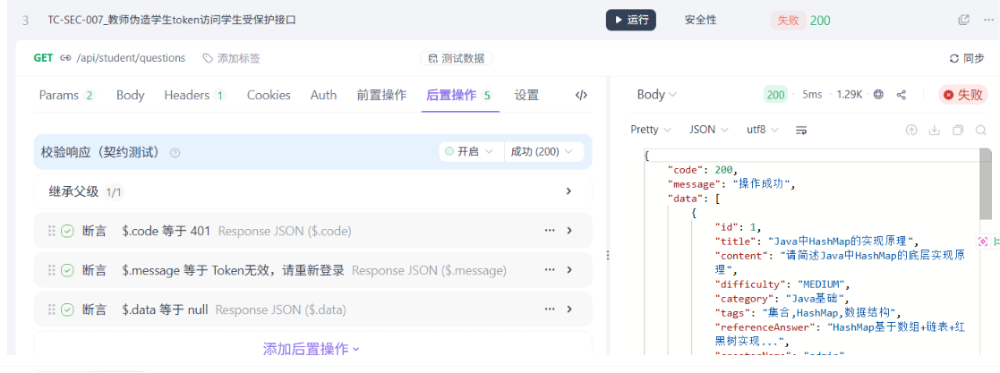
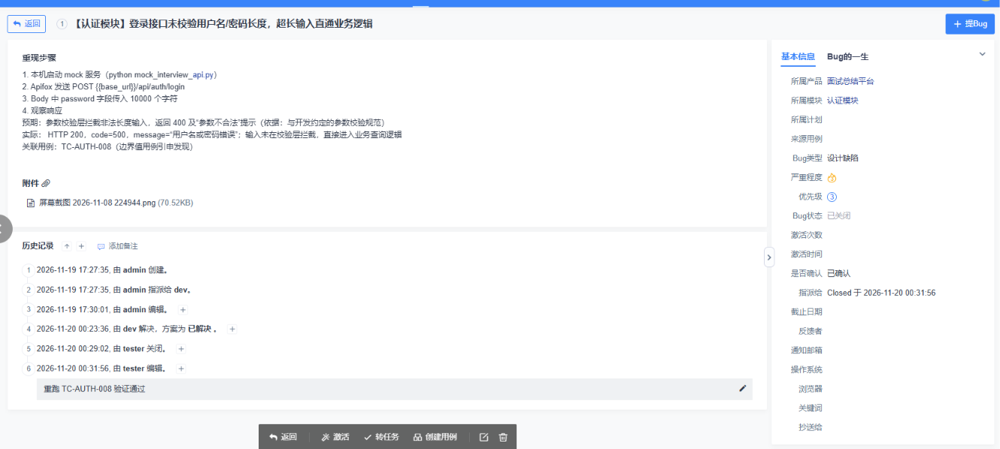
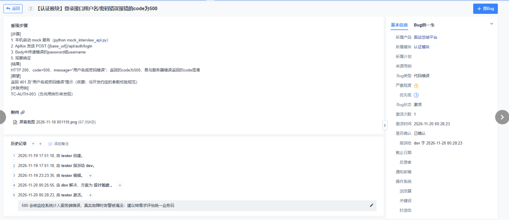
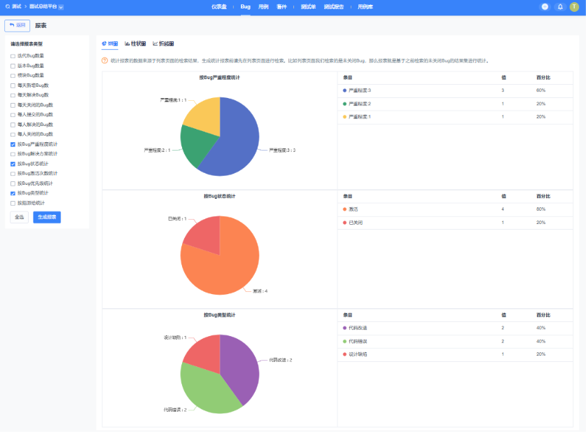

# 缺陷管理阶段报告

> 日期：2026-11-23　｜　项目：面试总结平台接口测试实训
> 状态：正式版 v1.0（2026-11-23 待填项补齐转正）
> 用途：简历「缺陷全生命周期管理」那句话的实物支撑，面试可出示

---

## 〇、数据口径说明（先把账对平）

- 禅道开源版 22.6，产品「面试总结平台」，模块：认证 / 学生 / 教师 / 公共接口
- **缺陷单 5 张**（#1~#5），Excel 双轨映射 BUG-001↔#1 … BUG-005↔#5
- 订正记录：早期笔记写「6 张」系误把 Excel 第 6 行行号（表头 1 行 + 数据 5 行）当成数量；2026-11-23 核对后全文统一为 5 张
- 另有 **1 条待确认问题**（不入缺陷单，见第五节）

---

## 一、缺陷总览表

| 禅道ID | Excel编号 | 标题（根因式） | 模块 | 严重程度 | 优先级 | 当前状态 | 发现方式 | 附件1 | 附件2 |
| --- | --- | --- | --- | --- | --- | --- | --- | :-: | :-: |
| #1 | BUG-001 | 登录接口未校验用户名/密码长度，超长输入直通业务逻辑 | 认证模块 | S3 | P3 | 已关闭（已解决） | 边界值用例 TC-AUTH-008 |  |  |
| #2 | BUG-002 | 登录接口用户名/密码错误时 code 为 500，应为业务错误码 | 认证模块 | S3 | P3 | 激活（设计如此 → 重新激活） | 负向用例 |  |  |
| #3 | BUG-003 | 可收藏他人未审核（未公开）的面试记录，存在水平越权与信息泄露 | 学生模块 | **S2** | P2 | 激活 | 权限矩阵用例 |  | 无 |
| #4 | BUG-004 | 收藏不存在的面试记录（原标【收藏模块】，已订正为【学生模块】） | 学生模块 | S3 | P2 | 激活 | 负向用例 |  | 无 |
| #5 | BUG-005 | 服务端未校验 token 签名，可篡改 payload 伪造角色 | 认证模块 | **S1** | P1 | 激活 | 安全测试（手工构造 token） |  |  |

---

## 二、生命周期走查记录（两条分支）

### 分支 A：#1 直线闭环

```
admin 创建 → 指派 dev → dev 解决（方案：已解决）→ tester 关闭
→ tester 补备注「重跑 TC-AUTH-008 验证通过」（2026-11-20 00:31）
```

要点：**关闭要有回归结论**——没有备注的关闭只是流程动作，补上"重跑哪条用例、结果如何"才算闭环。


### 分支 B：#2 回头路

```
创建 → 指派 dev → dev 解决（方案：设计如此）→ tester 重新激活
激活理由：500 会被监控系统计入服务端错误，真实故障时告警被淹没；建议转需求评估统一业务码
```

要点：**"设计如此"是分流不是失败**——两条正当回应：转研发需求 / 补"损害论据 + 可执行建议"重新激活。打回不带论据就是扯皮。


### 角色与权限

三角色 admin / tester / dev 在同一条历史记录里各留痕迹；dev 曾因未加入"研发"用户组导致功能不全 → RBAC 三层（账号→用户组→权限点+资源范围）的实战证据。

---

## 三、分布与结论

- 严重程度：S1×1（#5，JWT 不验签）、S2×1（#3，水平越权）、S3×3（#1，#2，#4）
- 模块分布：认证模块3张、学生模块2张
- **风险结论**：风险集中在认证与权限边界——伪造身份（S1）与跨用户数据访问（S2）均为服务端校验缺失，属同一根因族；建议优先推动服务端验签与资源归属校验，回归时用权限矩阵用例批量验证

---

## 四、双轨编号映射说明

- 缺陷编号由禅道系统自动发放（#1 自增），用例编号手工编制（TC-XXX-001 / BUG-00X）
- Excel 增加「禅道ID（正式由禅道生成）」列做双向映射，追溯链不断
- 【Excel 文件路径：E:\working\测试\我的缺陷管理.xlsx】

---

## 五、待确认问题清单（非缺陷）

| 问题 | 定性依据 | 建议 |
| --- | --- | --- |
| 录入接口创建的记录无法进入审核流，录入与提交流程数据脱节 | 接口文档定义 submit-review 为「新建待审记录」，文档=实现一致，非缺陷 | 向产品/开发确认录入接口的业务定位 |

要点：**测试发现的三个出口**——文档说 A 实现是 B → 缺陷单；文档=实现但业务说不通 → 待确认问题；用例设计错 → 改用例记教训。

---

## 六、遗留项收尾记录（2026-11-23）

- [x] #1 关闭备注补回归结论

- [x] #4 标题模块错位订正为【学生模块】

- [x] 确认无 #6 缺陷单（禅道「共 5 条」），全文数字统一

- [x] 禅道自带统计报表截图（测试 → 报告/统计，按模块/严重程度/状态分布）

  

- [x] 本报告【待填】项补齐 → 转正式版 v1.0（2026-11-23）

---

## 七、面试话术锚点

- "缺陷生命周期" → 五步 + triage 分诊，配 #1/#2 两条真实分支
- "被开发拒绝了怎么办" → 转需求 / 补论据重新激活两分法，配 #2 激活理由原文
- "权限怎么管" → RBAC 三层 + 最小权限，配 dev 用户组事故
- "编号怎么管" → 系统发 vs 手工编双轨，配 Excel 映射列
- 出示顺序：本报告总览表 → 禅道任一单详情（历史记录）→ Excel 双轨表

### 详细版（被追问时逐层展开，每条都配本报告真实数据）

> 用法：面试先抛锚点一句话，被追问再展开对应详细版；每条末尾的「追问」是第二层弹药。

**Q1「介绍一下你的缺陷管理流程？」**

> 我们项目里缺陷走全生命周期：激活 → 确认（可选担任 triage 分诊）→ 已解决 → 已关闭，回归不通过就重新激活。编号双轨制：缺陷号禅道自动发放防撞号，用例号手工编（TC-模块-序号）体现设计意图，Excel 加禅道ID列做映射保证追溯。我有一条铁律：**关闭必须带回归结论**——#1 单关闭时补了备注「重跑 TC-AUTH-008 验证通过」，没有回归结论的关闭只是流程动作，不是质量动作。

追问「确认环节是干嘛的」：不是前置关卡，是分诊——可判"不予解决/设计如此/重复/无法重现"；大厂做成固定 Bug Triage 会议，测试+开发+产品批量过新单。

**Q2「你提的 bug 被开发拒绝了怎么办？」**

> 两分法。建议类——转「研发需求」进需求池，这是生产环境的正解；不认可"设计如此"——重新激活，但**必须带损害论据 + 可执行建议**，打回不带论据就是扯皮。
> 真实案例：#2 登录失败返回 code=500，开发判"设计如此"。我激活打回，理由："500 会被监控系统计入服务端错误，真实故障时告警被淹没；建议转需求评估统一业务码"——论据指向可观测性损害，建议给了落地方向。

追问「开发还是不改呢」：记录分歧、摆数据（影响面/发生率），升级到 triage 让产品和团队拍板——测试推动决策，不独裁决策。

**Q3「你发现过最有价值的缺陷？」**

> S1 一枚：服务端不校验 JWT 签名。讲三层——
> **发现**：手工 base64 解码 token 三段结构，确认 header.payload.signature 格式后，只篡改 payload 的 role 字段、原样保留"签名"回传，服务端照单全收，以伪造的教师身份拿到了管理端数据；
> **影响面**：任何登录用户可把自己变成任意角色——认证体系整体失效而非单点功能缺陷，所以定 S1；
> **修复建议**：服务端必须验签（校验签名与过期时间），不能信任客户端可篡改的部分。
> 同根因族还有一枚 S2：水平越权——A 学生可收藏 B 学生未公开的记录，缺的是资源归属校验。两枚都指向"服务端校验缺失"，回归时用权限矩阵用例批量验证。

追问「怎么发现的」：不是瞎试——权限矩阵用例设计时推演出"token 由客户端持有、服务端如果只解不验就能伪造"，属于**用例设计引导出的安全测试**，比乱撞高级一档。

**Q4「权限怎么管？」**

> RBAC 三层：账号 → 用户组（角色）→ 权限点，外加资源范围（只能动被指派产品下的单），原则最小权限。
> 踩过一个真实坑：给 dev 建号漏配"研发"用户组，解决/关闭 Bug 的按钮全部消失——排障先分三层：**入口没找到 ≠ 视图差异（界面按权限裁剪菜单）≠ 真没权限（用户组未配）**，这次是第三层，改分组即修复。

**Q5「缺陷单怎么写才算好？」**

> 五要素：根因式标题（【模块】+现象+根因方向——#1 的标题"登录接口未校验用户名/密码长度，超长输入直通业务逻辑"，读完就知道测什么、错在哪）；复现三件套（步骤/预期/实际）；**预期结果标注依据出处**（引接口文档或约定，不裸奔）；严重程度×优先级双维分级；附件证据。
> 依据出处是我最看重的一条：预期不是"我觉得"，是"文档说"——和开发讨论时争的是事实，不是感觉。

追问「#1 为什么定 S3 不是 S2」：见下方定级思考题。

### 定级思考题（#1 的 S3 站得住吗）

#1「超长输入直通业务逻辑」定 S3/P3 不错，但有人会争 S2——**校验层缺失让脏数据直达业务层，且和注入类风险同族**。不用改定级，但面试被问"定级依据"要能答：

> "定 S3 的口径：行为可预期（返回业务错误）、无数据损坏、有参数校验规范兜底；若超长输入能引发注入或崩溃类后果则升 S2/S1。定级跟实际损害走，不跟'看起来吓人'走。"

这题答出来，比定级本身更加分。

**Q6「为什么第 3 步创建的是 3，第 6 步审核的是 4？不是同一条记录吧？」**（展示基线报告必被问）

> 创建接口（my-records）只做"仅自己可见的录入"；按接口文档 §3.1.5，submit-review 是"提交审核申请（新建待审记录）"——请求体同创建接口、无 id 参数，接口清单里不存在"按 id 送审"的能力。我最初把创建步的 id 传给审核接口时链路就断了：审的是没被提交的记录，id=4 成了没人审的孤儿。查文档后定性为文档=实现一致、非缺陷，转待确认问题清单；链路修正为两条变量各管一段语义（`student_a_record_id` 管录入、`submitted_record_id` 管送审→审核），并新增"教师查待审"做下游可见性断言，8 步 53 断言全绿。

追问「重启后 id 变了，你的场景还能跑吗」：能——审核路径引用变量 `submitted_record_id` 而非硬编码 id；2026-11-23 重启清场后 id 序列从 3 重新开始，场景照跑全绿（基线报告实证）。措辞注意：说"清单里不存在该能力"（可验证），别说"我没找到"（会被追问翻全了没）。
